# CornerBreak · 角落小憩

给忙碌的工作留一点休息时间。CornerBreak 是轻量的 Windows 桌面休息提醒工具，平时用常驻小挂件显示休息伙伴和下次提醒倒计时，到休息时段展开卡片，提醒你休息眼睛、喝水和起身活动。

当前版本：**0.2.0**。程序使用 C# / Windows Forms，运行时无需 PowerShell 或 VBScript。

## 图文介绍

六张介绍图生成于 v0.1.0，展示三项提醒、渐进放大和伙伴选择等功能。图片由 AI 生成，其中的软件界面和尺寸变化为示意；v0.2.0 新增的常驻小挂件见[下方的实际界面](#实际界面)。程序截图来自 EXE 预览模式。点击图片可查看大图。

<table>
  <tr><th>01 · 提醒会慢慢长大</th><th>02 · 三项休息提醒</th></tr>
  <tr>
    <td><a href="docs/images/promo-01-cover.png">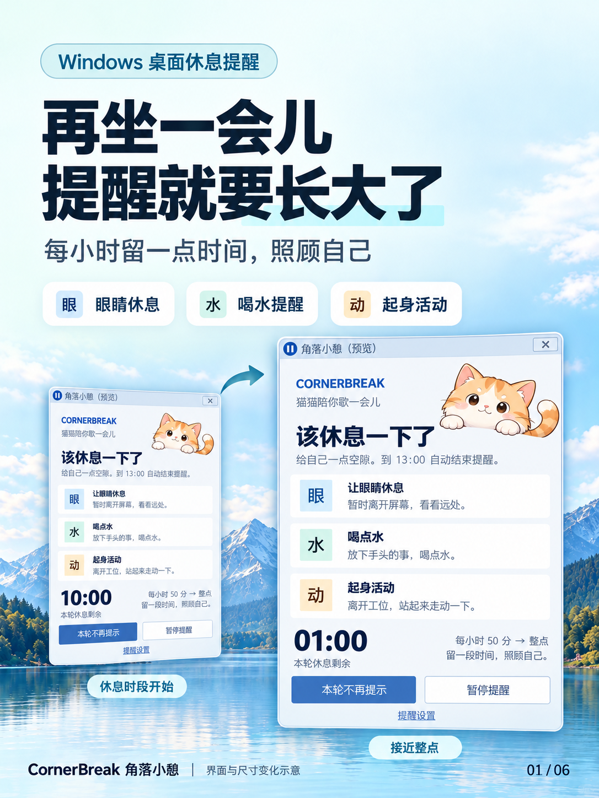</a></td>
    <td><a href="docs/images/promo-02-reminders.png">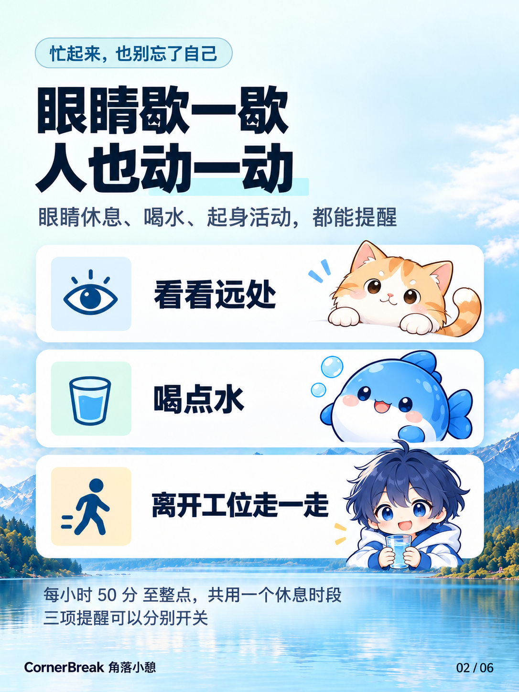</a></td>
  </tr>
  <tr><th>03 · 越接近整点越醒目</th><th>04 · 选择休息伙伴</th></tr>
  <tr>
    <td><a href="docs/images/promo-03-growth.png">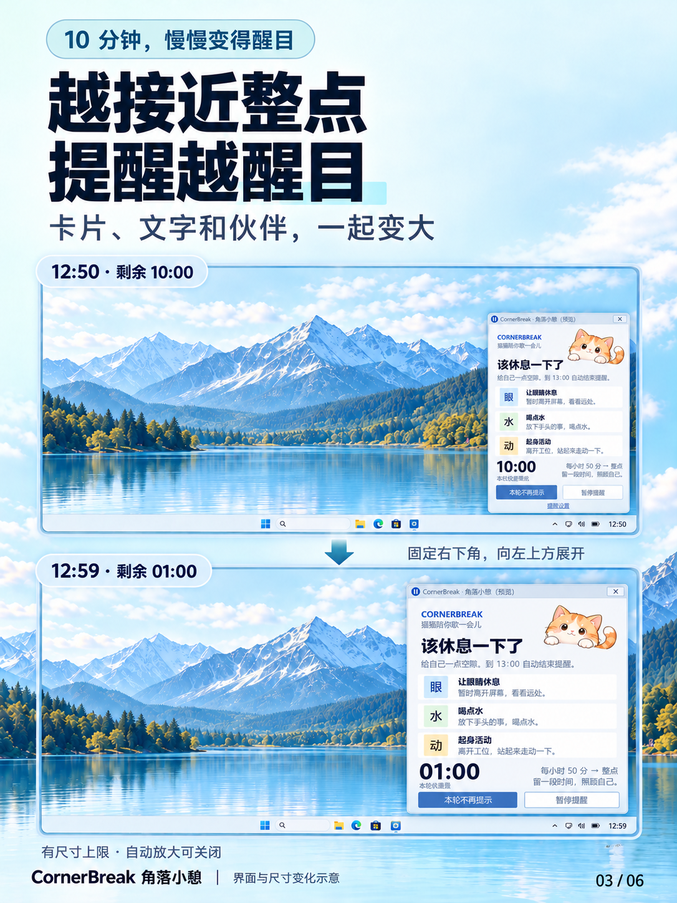</a></td>
    <td><a href="docs/images/promo-04-companions.png"></a></td>
  </tr>
  <tr><th>05 · 灵活暂停与跳过</th><th>06 · 本地 EXE 使用</th></tr>
  <tr>
    <td><a href="docs/images/promo-05-pause.png">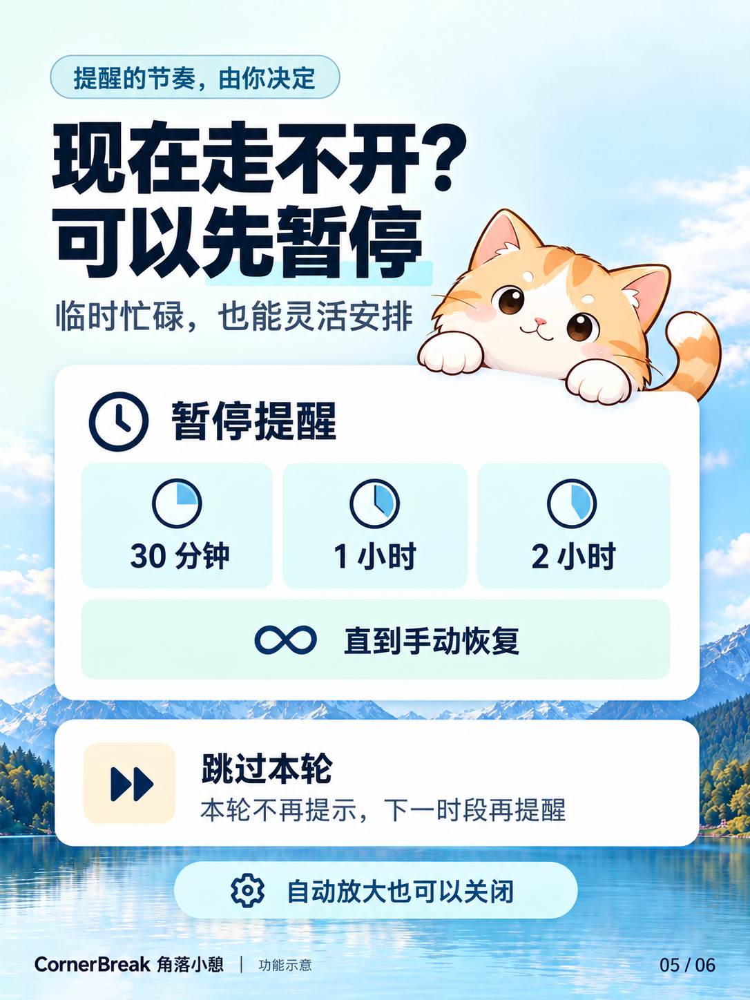</a></td>
    <td><a href="docs/images/promo-06-local-app.png">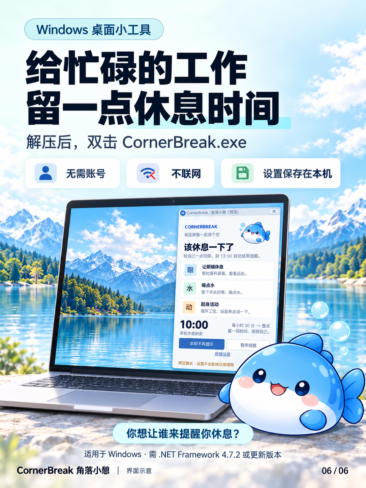</a></td>
  </tr>
</table>

## 下载与运行

1. 在本仓库的 **Releases** 页面下载 `CornerBreak-v0.2.0-windows.zip`。
2. 完整解压到有写入权限的文件夹。
3. 双击 **CornerBreak.exe**。默认显示常驻小挂件并保留托盘图标，到休息时段自动展开提醒卡片。

运行环境：Windows，**.NET Framework 4.7.2 或兼容更新版本**。无需安装开发工具，不需要管理员权限。

三张角色图片已嵌入 EXE，无需额外放置 `assets` 文件夹。请保留随附的 `CornerBreak.exe.config`。首次保存设置时，程序会在 EXE 同目录创建 `Data/settings.json`；搬迁或升级时保留 `Data` 文件夹即可保留个人设置。

重复启动会打开已有程序的状态窗口。退出请右击托盘图标并选择“退出 CornerBreak”。

## 功能

- **常驻小挂件**：默认开启，平时显示角色和下次休息倒计时；暂停或跳过后继续显示对应状态。可拖动并记住位置，点击查看详情，右击打开菜单。
- **三项提醒**：眼睛休息、喝点水、起身活动，可以分别开关。
- **固定休息时段**：每小时的 50 分到下一个整点，例如 14:50—15:00；中途打开也会显示实际剩余时间。
- **渐进放大**：休息时段开始时保持常态，随后卡片、角色、文字逐渐变大，越接近整点越明显。
- **三种休息伙伴**：猫猫探头、蓝色大肥鱼、二次元伙伴，也可选择不显示角色。
- **暂停与跳过**：暂停 30 分钟、1 小时、2 小时或至手动恢复；可以跳过本轮提醒。
- **本地保存**：设置、角色、暂停及本轮跳过状态保存在本机；程序不联网，不自动设置开机启动。

## 常驻与定时弹出

默认开启“常驻小挂件”：平时显示小伙伴和下次休息倒计时；每小时 50 分进入休息时段，展开原有提醒卡片。整点结束、暂停或跳过本轮后，回到小挂件并显示当前状态。自动显示不会抢走正在输入的焦点。

点击小挂件打开详情；按住拖动可调整位置，释放后记住位置；右击可使用查看状态、暂停、伙伴切换及设置等菜单。关闭角色显示后，挂件仍保留文字状态。

在“提醒设置”中取消“常驻小挂件（平时显示下次休息）”，或从托盘菜单切换“常驻小挂件”，可使用定时弹出模式。关闭自动放大只会固定提醒卡片尺寸，不会关闭小挂件。

详情窗口的 **×** 和托盘“收起详情”只收起详情，保留当前提醒状态；**“本轮不再提示”才会跳过本轮**。收起不会重新开始倒计时。退出程序请使用托盘“退出 CornerBreak”。

## 实际界面

以下程序截图均通过 EXE 预览模式生成。

<table>
  <tr><th>等待下一次休息</th><th>暂停时仍然可见</th></tr>
  <tr>
    <td>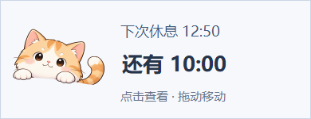</td>
    <td></td>
  </tr>
</table>

<p align="center">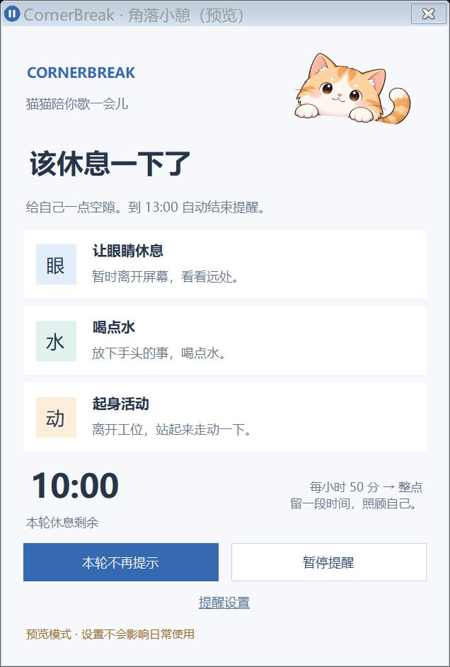</p>

## 选择休息伙伴

在“提醒设置”中查看预览并保存，或通过托盘的“休息伙伴”菜单立即切换。取消设置不会改变原选择。

<table>
  <tr><th>猫猫探头</th><th>蓝色大肥鱼</th><th>二次元伙伴</th></tr>
  <tr>
    <td></td>
    <td>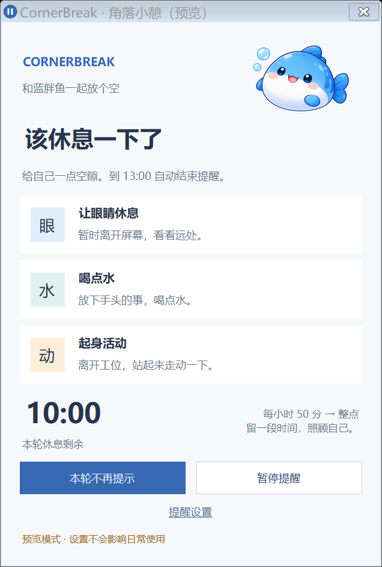</td>
    <td>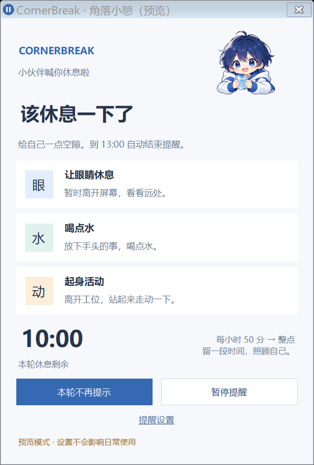</td>
  </tr>
</table>

## 倒计时渐进放大

卡片默认在当前屏幕右下角向左上方扩展；移动小挂件后，提醒会跟随挂件所在屏幕和位置，并保持在工作区内。上限约为当前屏幕工作区宽度的一半、高度的 80%，并始终受屏幕边界限制。鼠标停留、拖动窗口、打开菜单或设置时暂缓放大，操作结束后平滑继续。暂停、跳过本轮或休息结束后恢复常态。

<table>
  <tr><th>剩余 10:00</th><th>剩余 01:00</th></tr>
  <tr>
    <td valign="bottom"></td>
    <td valign="bottom">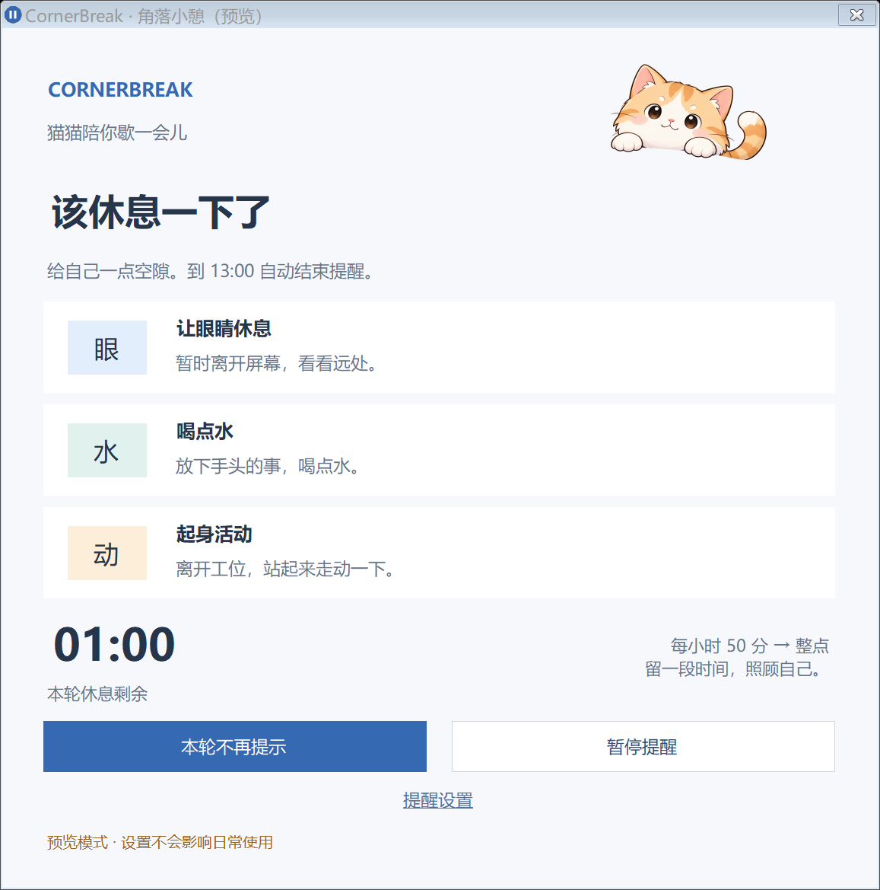</td>
  </tr>
</table>

也可在设置中关闭“随倒计时逐渐放大”，使用固定尺寸提醒。

<details>
  <summary>查看提醒设置</summary>
  <p>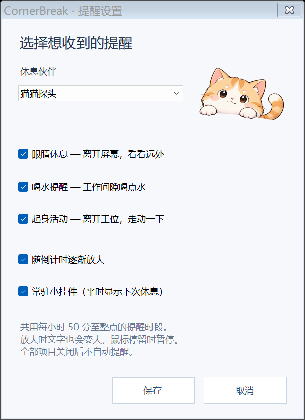</p>
</details>

## 使用提示

- 点击“本轮不再提示”会收起卡片并跳过当前休息时段。跳过状态在重启后仍然有效，到本轮结束时失效；常驻模式下小挂件继续显示本轮已跳过。
- 正式运行时关闭详情窗口的 × 或使用“收起详情”只收起详情，不会写入本轮跳过状态。
- 托盘“查看状态”不会取消本轮跳过。
- 限时暂停到期后，程序按正常休息时段规则恢复提醒。
- 选择“不显示角色”会收起角色区域，保留文字与倒计时。
- 迁移原脚本版时，将新程序和配置文件放在原目录，保留原有 `Data/settings.json` 即可继续使用原设置。
- 从 v0.1.0 或旧脚本版升级后，缺少的新设置会使用常驻小挂件默认值，原有提醒开关、角色、暂停和跳过状态继续保留。可随时在设置中切回定时弹出。

完整操作说明见 [使用说明.txt](使用说明.txt)。

## macOS 实验测试版

现已提供独立的 **macOS 0.2.0-beta.1** 测试项目，包含常驻挂件、三项提醒、暂停与伙伴选择。目标系统为 macOS 14 及以上，分别提供 M 系列芯片（ARM64）和 Intel（x64）自包含包，无需另装 .NET。

Mac 包由 Windows 交叉构建，尚未经过 Mac 实机验证，未进行 Developer ID 签名或 Apple 公证。请将它作为受邀测试版本使用。安装、芯片选择和反馈方式见 [Mac 内测说明](macOS/README.md)。Windows 稳定版仍为 0.2.0。

## 从源码构建

开发构建需要 Windows PowerShell 5.1 和 .NET Framework 4.7.2 或兼容更新版本。构建脚本使用系统自带的 .NET Framework C# 编译器，无需 NuGet 包。

在项目目录打开 PowerShell：

```powershell
# 编译程序并运行原生 C# 测试
.\Build.ps1 -Test

# 启动构建后的程序
.\dist\CornerBreak.exe

# 构建、测试并生成发布 ZIP 与 SHA256 文件
.\Package.ps1
```

默认构建输出为 `dist/CornerBreak.exe`，发布包输出到 `release/`。已有经过验证的构建时，可执行 `./Package.ps1 -SkipBuild` 直接打包。发布 ZIP 仅包含 EXE、运行配置、文档、文档图片，以及仓库中已有的 `LICENSE`（如有）；不包含个人 `Data`、测试输出、开发脚本或历史备份。

`Build.ps1` 编译根目录 C# 源码为独立的 Windows 桌面程序，并将 `assets/mascots` 下的三个 PNG 嵌入 EXE。运行 EXE 不会调用 PowerShell 或 VBScript。

源码目录中可能存在用于本机日常运行的 `CornerBreak.exe`，它和 `dist/` 都是本地构建产物，已被 Git 忽略。根目录的 `CornerBreak.exe.config` 是构建所需的源文件，应提交到仓库。

## 开发预览

预览使用独立实例和内存设置，不修改日常使用的 `Data/settings.json`。

```powershell
.\dist\CornerBreak.exe --preview
.\dist\CornerBreak.exe --preview --previewmascot fish
.\dist\CornerBreak.exe --preview --previewat "2026-10-25T12:59:00" --renderpreview "preview.png"
.\dist\CornerBreak.exe --preview --rendersettings "settings.png"
.\dist\CornerBreak.exe --preview --previewscenario Waiting --render-widget "widget-waiting.png"
.\dist\CornerBreak.exe --preview --previewscenario Paused --render-widget "widget-paused.png"
```

`--previewmascot` 可选 `cat`、`fish`、`companion`、`none`。`--previewscenario` 可选 `Active`、`Waiting`、`Skipped`、`Paused`、`Disabled`。`--render-widget` 导出小挂件，其他导出参数用于详情或设置。导出截图需要同时使用 `--preview`。
